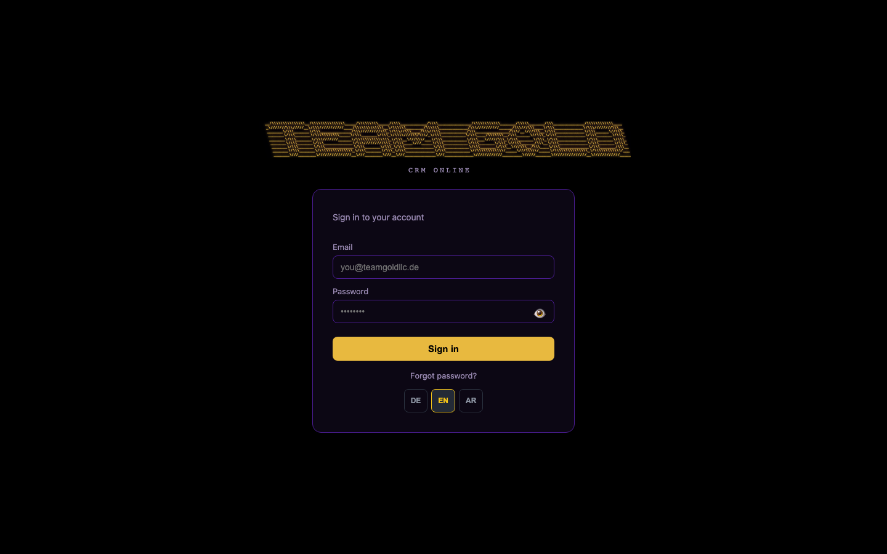
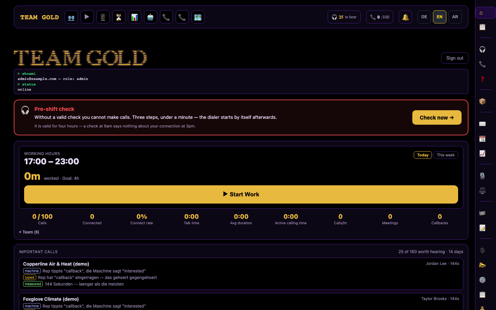
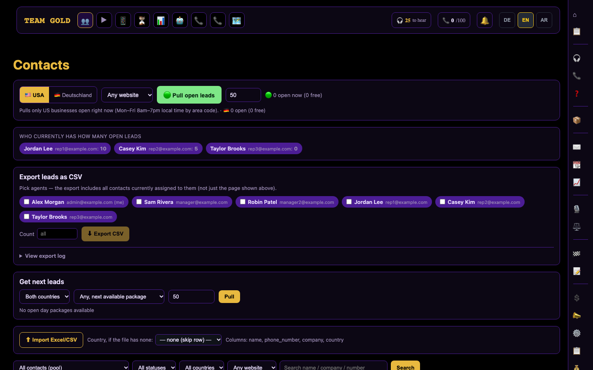
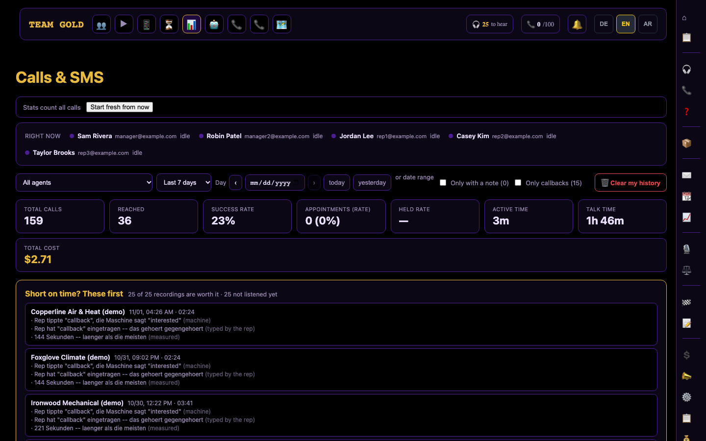
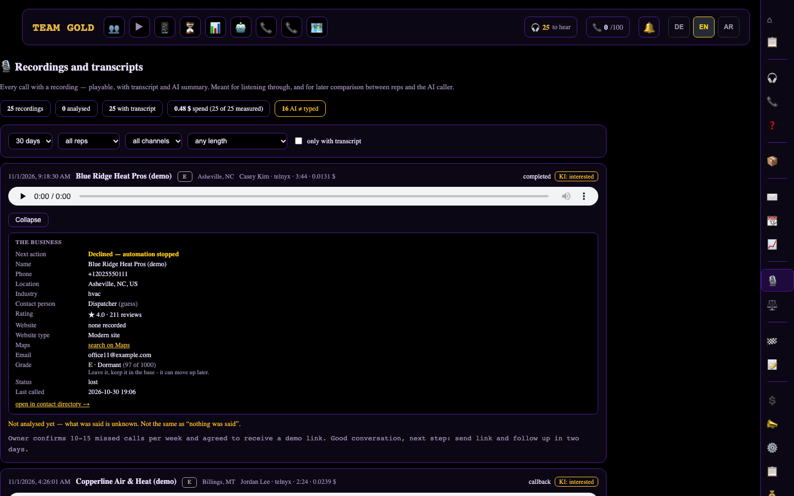
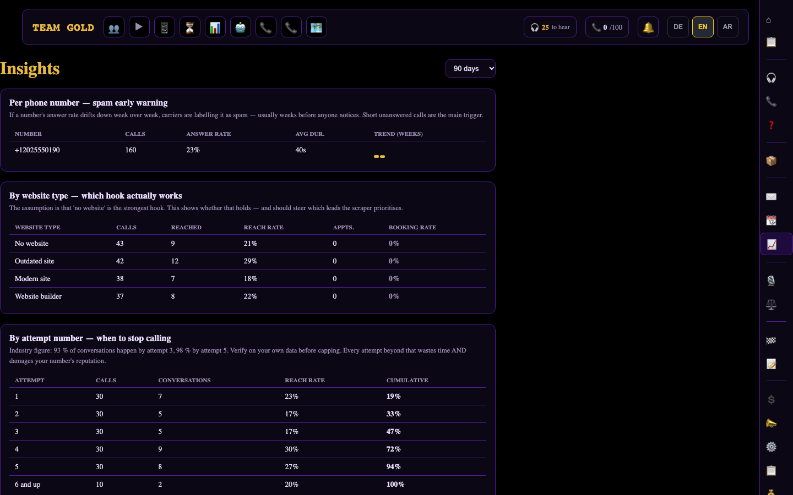
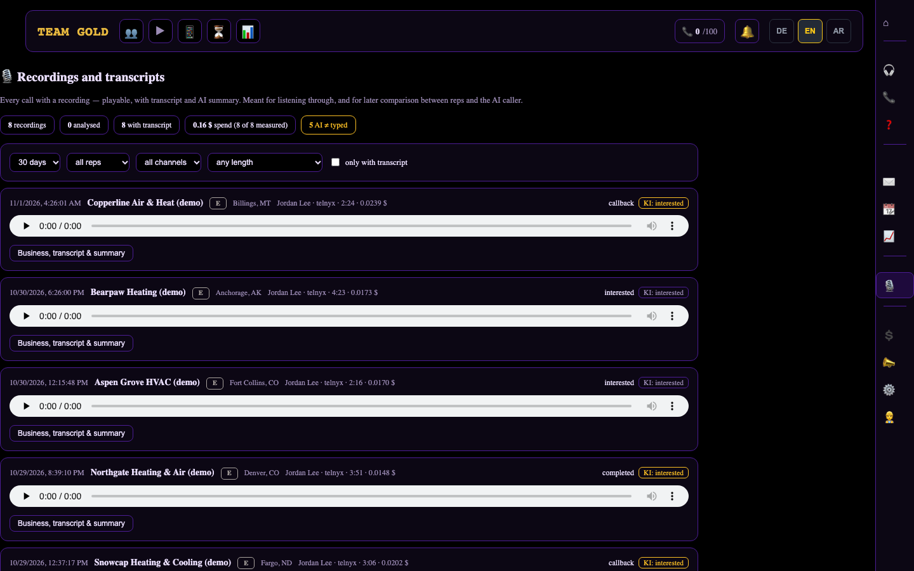

<!-- Purpose: page-by-page tour of the CRM with synthetic-data screenshots. Depends on docs/images and README.md. Claims come from reviewed source and from the running app; none certify the deployed production state. -->
# Feature tour

A walk through the dashboard, in the order a sales representative meets it. Every image is a capture of the private application against a synthetic dataset (invented businesses marked "(demo)", reserved `555-01xx` numbers, `example.com` addresses). A 1-minute recording is in [docs/media/demo.mp4](media/demo.mp4).

## 1. Sign-in and languages

- Email and password sign-in through Supabase Auth, with a show/hide toggle for the password.
- The interface switches between **English, German and Arabic** (Arabic renders right-to-left). The choice is stored in the browser; English is the default.
- Employees are onboarded with an **access link** instead of a mailed invitation: the link carries a token of our own that is spent only when the person submits a password. Mail and chat link scanners that open links for previews therefore cannot burn the first link.

## 2. Dashboard

- **Pre-shift check:** microphone, "can you hear yourself" and connection tests before calling. A passed check is valid for four hours, because a check at 9 am says nothing about the connection at 3 pm.
- **Shift timer and daily goal:** working hours, time worked and a soft calls-per-day goal.
- **Day numbers:** calls, connected calls, connect rate, talk time, average duration, active calling time, calls per hour, meetings and callbacks.
- **Calls worth hearing:** a short list of conversations where the representative's typed outcome and the machine's reading of the call disagree, or where the call was unusually long, so a manager does not have to listen to everything.

## 3. Contacts and lead release

- **Lead pools** for the US and Germany, filterable by status, country and website type, with name/company/number search.
- **Controlled release:** representatives pull leads in batches. For US leads the pull respects local business hours derived from the area code, so a pull returns only businesses that are open now.
- **Visibility of workload:** a strip shows how many open leads each representative currently holds.
- **Import and export:** Excel/CSV import with a fallback country for rows without one, and CSV export per selected representative with an export log.
- **Bulk actions:** assign selected contacts, remove an assignment, or send a selection straight into the auto dialer.

## 4. Calls and SMS

- Totals for the chosen period: calls, reached, success rate, appointments, held rate, active time, talk time and cost.
- A live strip with who is idle or on a call.
- Filters by representative, period, single day or date range, notes and callbacks.
- A "short on time? these first" block ranks the recordings most worth hearing.

## 5. Recordings, transcripts and AI summaries

- Every recorded call is playable in the browser. The recording URL stored with the call points to an application route that fetches a **fresh download link from the telephony provider on every play**, because the provider's links expire after minutes. Access to that route is gated by the same row-level rules as the call itself.
- Expanding a call shows the business record (location, rating, website type, grade, status), the transcript and an AI summary.
- Filters: period, representative, channel, minimum length, transcript present.

## 6. Insights

- **Per phone number:** answer rate and trend by week, an early warning when a carrier starts labelling a number as spam.
- **By website type:** which hook ("no website", "outdated site", …) actually reaches and books.
- **By attempt number:** how conversations accumulate over attempts, to decide when to stop calling a lead.

## 7. Team management and scoped access

Administrators invite employees and set per-person rights (pulling leads, daily limits and batch size, calling mobile or German numbers, CSV export, script editing, SMS, availability status). A **manager** role sees and manages only the people they invited; see [Roles and access](ROLES-AND-ACCESS.md).

## Present in the application, not shown here

The navigation also contains: call scripts with versions and per-account assignment, call-path analysis, open calls without an outcome, a mobile dialer, sent-email log, daily recap, outreach campaigns and inbox, AI-caller controls with an emergency stop, an AI test console and a spend overview. They are not captured here, either because they depend on provider accounts or because their text is not yet fully localised.
