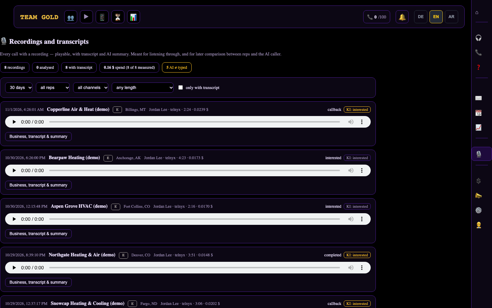

<!-- Purpose: explains the three roles and how team-scoped access works. Depends on README.md and docs/images. Describes tested behaviour in a local environment, not the production deployment. -->
# Roles and access

The CRM distinguishes three roles. The same dashboard serves all of them; what changes is which rows a person can read and which actions the server accepts.

| | Agent | Manager | Admin |
|---|---|---|---|
| Own calls, contacts, recordings | yes | yes | yes |
| Calls, recordings, daily recap and insights of **invited** people | no | yes | all people |
| Invite new people | no | yes, as agents under them | yes, any role |
| Change rights, availability, access link, password | own settings only | for the agents they invited | everyone |
| Change roles, delete accounts | no | no | yes |
| AI-caller controls and spend | no | no | yes |
| Call review, AI review, feedback queue | no | no | yes |

## How the scoping works

- Each account carries an `invited_by` reference. A manager's scope is "myself plus everyone with `invited_by` = me".
- **Database level:** additional row-level-security policies let a manager read call and contact rows whose owner is in that scope. A helper function answers "is the signed-in user the manager of this account?".
- **Server level:** routes that use a privileged database client (recordings, daily summaries, activity totals, agent lists) apply the same scope explicitly, because a privileged client bypasses row-level security. Mutating routes (rights, availability, access link, password) additionally require that the target is an agent invited by the caller.
- **Privilege boundary:** a manager can invite only **new** accounts and only as agents. Inviting an address that already exists is refused, otherwise a manager could take over an existing administrator account. Whatever role a client sends, the server forces `agent`.

## What was checked

On a local database seeded with synthetic data (two managers, three agents):

- Manager A sees only their own agent's recordings, calls, users and recap; manager B sees only theirs; an agent without a manager is visible to neither.
- Playback of another team's recording returns "not found".
- For another team's agent, for another manager's agent and for themselves, the rights, availability, access-link and password actions are refused.
- Role changes, deletion, AI-caller costs and call review are refused for a manager.
- An invited agent is created with role `agent` and the inviting manager recorded, even if a different role is requested.
- The administrator still sees all recordings and accounts.

This was verified in a local environment. The manager role is implemented in a reviewed branch and **is not claimed to be deployed in production**.

*Same Recordings page as an administrator sees it, but a manager gets 8 of the 25 recordings, all from the one agent they invited.*

## Known limits

- Call review, AI review and the feedback queue are deliberately administrator-only: they hold the administrator's own ratings and run on privileged queries that were not scoped.
- The SMS timeline for a manager shows only their own messages, not those of invited agents.
